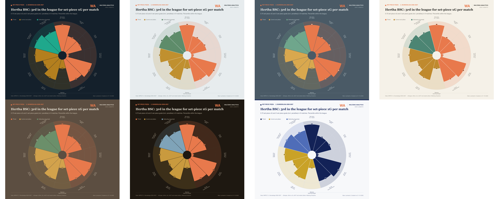

# wa-restarts

**IMPECT event data in, set-piece and restart analysis out.** Point it at a folder of IMPECT match JSON for one
league-season and it builds:

- a **league folder**: restart options per restart type, club set-piece profiles and a 24-chart visual pack (pitch
  maps, scatters, pizzas, beeswarms, bars, box plots), each with its CSV;
- a **club pack** for any club: 59 charts on its attacking and defending restarts, plus every restart as CSV;
- **xDanger** for every action, player and team (see [xDanger](#xdanger)).

Each restart is scored with pre-trained models (xG, xGOT, xDanger, xShot). The models were trained on every IMPECT
league from 2024 to 2027 by [Waltzing Analytics](https://github.com/marclamberts). Nothing is retrained, and a league
of about 300 matches takes under a minute on a laptop.

 

## Install

```bash
git clone https://github.com/marclamberts/wa-restarts.git
cd wa-restarts
pip install -e .
```

Python 3.10+. The bundled models are LightGBM 4.6.0 / scikit-learn 1.7.2 pickles, and those two versions are pinned
so the models load.

## Data

You need IMPECT event data (your own IMPECT access; no data ships with this repo). The layout is:

```
events_json/
  3. Liga 2026-2027/                       # one folder per league-season (the name is used in the charts)
    2026-08-01_Home_Club_vs_Away_Club_123456.json   # IMPECT events for one match (the API's event list)
    ...
events_meta/                                # optional, next to events_json
  3. Liga 2026-2027/
    squads.json                             # IMPECT squads: proper club names with accents
    matches.json                            # IMPECT matches: home side per match
```

The file name must end in `_<matchId>.json` and start with the date. Without `events_meta`, club names are read from
the file names, which lose their accents.

## Use

Command line:

```bash
wa-restarts --json-root events_json leagues
wa-restarts --json-root events_json teams "3. Liga 2026-2027"
wa-restarts --json-root events_json build "3. Liga 2026-2027" --club "Rot-Weiss Essen" --club "Hansa"
wa-restarts --json-root events_json league "3. Liga 2026-2027" --focus "Essen"   # league folder only
wa-restarts --json-root events_json club "3. Liga 2026-2027" "Essen"            # club pack only
```

Python:

```python
import wa_restarts as wr

wr.configure(json_root="events_json", out_root="wa_restarts_output")
wr.teams("3. Liga 2026-2027")
wr.build("3. Liga 2026-2027", teams=["Rot-Weiss Essen"])
```

Notebook: [`notebooks/restarts_pack.ipynb`](notebooks/restarts_pack.ipynb) is one cell. Set the league folder, clubs,
style and credits, then run it.

Scoring is cached in `~/.cache/wa_restarts/<league-season>/` and reruns on its own when new match files arrive
(`--refresh` forces a rerun).

## Output

`wa_restarts_output/<league-season>/`

| Path | Contents |
|---|---|
| `restart_options.csv` | every restart option: volume, share, reach danger, peak xShot, xG, xGOT, goal, pillars, vs its restart type, vs all IMPECT leagues |
| `team_set_piece_profiles.csv` | club set-piece profile |
| `charts/O_*.png` | overview, one table per restart type, club profiles |
| `visual pack/B01..B24_*.png` | corner landing maps, long throws, free-kick deliveries, goal-kick destinations, set-piece shot map, scatters, pizzas (top two, bottom, focus club), beeswarms, stacked bars, box plots |
| `visual pack/club_set_piece_table.csv`, `club_percentiles.csv` | tables behind the visual pack |
| `<club> set pieces/NN_*.png` | 59-chart club pack |
| `<club> set pieces/restarts_for.csv`, `restarts_against.csv`, `league_set_piece_table.csv` | every restart by and against the club, and the league table |

## xDanger

**xDanger is how dangerous the next 15 seconds are for the team on the ball: the most dangerous moment it is expected
to reach, as a goal probability.** A shot counts at its xG. A dangerous moment that needs no shot counts at the share of
those moments followed by a goal within 15 s. The goal rates below come from 69M actions in the training seasons:

| Danger event | Goal within 15 s |
|---|---|
| Golden-zone touch (penalty spot to goal line, six-yard-box width) | 16.5% |
| Cutback (completed pass from near the byline back into the box) | 11.8% |
| Box entry by carry / by pass | 7.3% / 7.2% |
| Free kick within 30 m | 4.1% |
| Corner | 3.4% |
| Final-third regain | 3.0% |

The model is a LightGBM regression on every on-ball action: start and end location, type, result, pressure, opponents,
the two previous actions and possession context. On the held-out 2026 and 2026-2027 seasons its Brier skill over a
constant baseline is 25%, and it is calibrated across 20 bins. It ships in `wa_restarts/reference/models/`.

```python
import wa_restarts as wr

wr.configure(json_root="events_json")
actions = wr.xdanger_actions("Eredivisie 2026-2027")              # one row per on-ball action
players = wr.xdanger_players("Eredivisie 2026-2027", min_minutes=450)
teams = wr.xdanger_teams("Eredivisie 2026-2027")
wr.xdanger("Eredivisie 2026-2027")   # writes <out>/<league>/xdanger/: xdanger_actions.parquet, player_xdanger.csv, team_xdanger.csv
```

```bash
wa-restarts --json-root events_json xdanger "Eredivisie 2026-2027"
wa-restarts --json-root events_json build "Eredivisie 2026-2027" --club Ajax --xdanger
```

**Per action** (`xdanger_actions`):

| Column | Meaning |
|---|---|
| `xdanger` | danger of the next 15 s after the action (for the team in possession) |
| `xd_before`, `xd_after` | value of the moment before and after the action. For a restart, "before" is the average outcome of that restart type from that 10 m zone |
| `xd_added` | `xd_after - xd_before` for the attacking team. Shots carry none (see `xd_shot_sel`), and the value of controlling a completed pass goes to the passer |
| `xd_won` | xDanger at the first action of a possession the team wins (not a restart) |
| `xd_denied` | the attacking team's latest xDanger, ended by an interception, regain, block, clearance, duel or keeper action |
| `xd_shot_sel` | a shot's xG minus the danger of the moment it was taken from (shot selection) |
| `xd_received`, `xd_rec_control` | danger of the spot where a pass is received, and what the first touch adds |
| `danger_event` | the danger event the action is, if any |
| `xg`, `xshot`, `xs_added` | shot xG; chance of a shot in the next 15 s, and its change |

**Per player** (`xdanger_players`): totals and per 90 of xDanger added (split into passes, carries and other), won,
denied, shot selection, received and reception control, plus xG, danger-event counts (`n_*`) and minutes. Receiver
values are also shown relative to the team's outfield average (`*_vs_team_p90`), because about a third of them is team
effect.

**Per team** (`xdanger_teams`): xDanger for and against per match, counting positive in-possession xDanger added only
(this version predicts future goals better than xG), plus xG for and against.

Minutes are estimated from first and last touch per period, so per-90 numbers run slightly high for substitutes.

## Method

Every corner, free kick (direct and indirect), throw-in, goal kick, kick-off and penalty is scored over the **30 s of
live play** after it. The window stops early at the next restart, a goal, or a gap of more than 10 s.

| Measure | Meaning |
|---|---|
| xG | chance a shot is a goal before it is struck (LightGBM, ~625k shots) |
| xGOT | chance an on-target shot is a goal given where it was placed |
| xDanger | how dangerous the next 15 s are: the most dangerous moment the team is expected to reach (shots by xG, box entries, cutbacks and golden-zone touches by their observed goal rate) |
| xShot | chance the team shoots in the next 15 s |
| Reach danger | the restart reaches an xDanger moment of 5%+ |
| Peak xShot | highest xShot the taking team reaches in the window |
| Another set piece | the window ends with the taking team awarded a corner, penalty, opponent-half free kick or final-third throw-in |
| Retention | the taking team still has the ball when the window ends (a goal counts as kept) |
| Dominance | share of events in the window that are the taking team's in the attacking third |
| Second ball | the taking team wins the first loose ball |
| Delivery / peak above expected | danger at the delivery and at the peak, against the average for the same restart type and 10 m zone (training seasons, all leagues) |

**Options** classify each restart: corners by swing (from the taker's foot) and target zone, or as short corners with
what came next. Free kicks are split by half, box delivery and distance. Throw-ins are split by zone, length and
direction. Goal kicks and kick-offs are split by destination, and penalties by placement.

## Styles

Seven colour themes. Six of them make up the Waltzing Analytics grid: cool or warm, crossed with light, mid or dark.
The seventh is a club theme. The coral accent stays the same everywhere except the club theme.



| | Light | Mid | Dark |
|---|---|---|---|
| **Cool** | `fog` | `dusk` | `navy` (default) |
| **Warm** | `cream` | `clay` | `espresso` |
| **Club** | `xhotspur`: lilywhite with Spurs navy as the accent, a navy top band, and the coral mark | | |

```bash
wa-restarts --style fog build "3. Liga 2026-2027"
wa-restarts styles
```

In Python, call `wr.configure(style="espresso")`. Values printed on filled cells switch between light and dark text so
they stay readable in every theme.

## Credits

Every chart carries a header (mark, wordmark, author) and a footer (source line, author and date). Each part is a
setting:

| Setting | Where it shows | Default |
|---|---|---|
| `author` | "made by", in the header and footer | Marc Lamberts |
| `brand` | wordmark in the header | Waltzing Analytics |
| `mark` | short mark in the header | WA |
| `data` | data credit in the source line | IMPECT |
| `models_by` | model credit in the source line (empty string drops it) | Waltzing Analytics |

```python
wr.configure(author="Your Name", brand="Your Brand", mark="YB", data="IMPECT", models_by="Waltzing Analytics")
```

The CLI takes the same settings as `--author`, `--brand`, `--mark`, `--data` and `--models-by`. The environment
variables are `WA_RESTARTS_AUTHOR`, `_BRAND`, `_MARK`, `_DATA`, `_MODELS_BY` and `_STYLE`. The notebook has them as
variables next to `CLUBS`.

## Fonts

Headings use Georgia and body text uses Helvetica Neue. On other systems the nearest installed font is used (Arial,
Liberation, DejaVu). On macOS matplotlib reads only the first face of Helvetica Neue's `.ttc`; for the exact look, put
extracted `.ttf` faces in `wa_restarts/fonts/` (git-ignored, not redistributable).

## Settings

| Setting | Flag | Environment | Default |
|---|---|---|---|
| JSON root | `--json-root` | `WA_RESTARTS_JSON` | `./events_json` |
| Metadata root | `--meta-root` | `WA_RESTARTS_META` | `events_meta` next to the JSON root |
| Output | `--out` | `WA_RESTARTS_OUT` | `./wa_restarts_output` |
| Cache | `--cache` | `WA_RESTARTS_CACHE` | `~/.cache/wa_restarts` |
| Models and reference tables | | `WA_RESTARTS_REFERENCE` | `wa_restarts/reference/` |

## Reference files

`wa_restarts/reference/` holds:

- the four models;
- the training-season goal rate after each danger event;
- the restart-option table across all IMPECT leagues (the "all leagues" comparison);
- the expected danger curve per restart type and zone.

The 2026 and 2026-2027 seasons were held out of training. Rebuild the folder from the full xDanger project after
retraining with:

```bash
python -m wa_restarts.build_reference /path/to/xDanger
```

## Caveats

- Single-league samples are small: options with fewer than 60 restarts (30 for direct free kicks) are left off the
  option charts, and penalty and direct-free-kick maps need more than one league-season.
- Restart windows are built from event timestamps, so a stoppage IMPECT does not record is treated as live play until
  a 10 s gap.

## Licence

MIT © Marc Lamberts (Waltzing Analytics). Event data is IMPECT's and is subject to your IMPECT licence.
